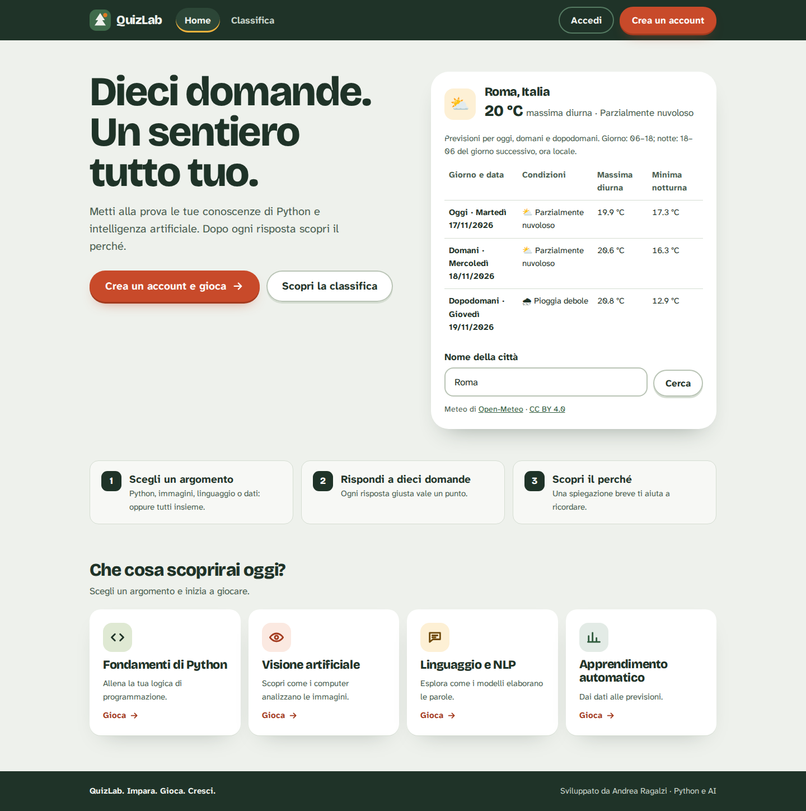
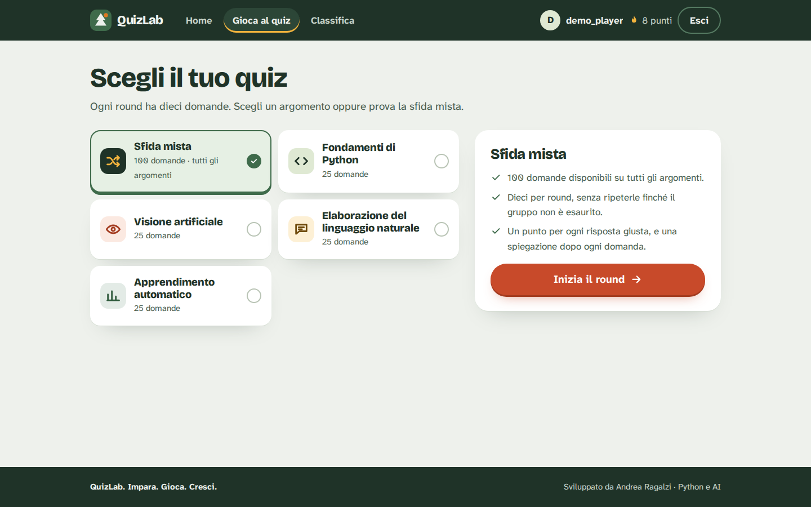
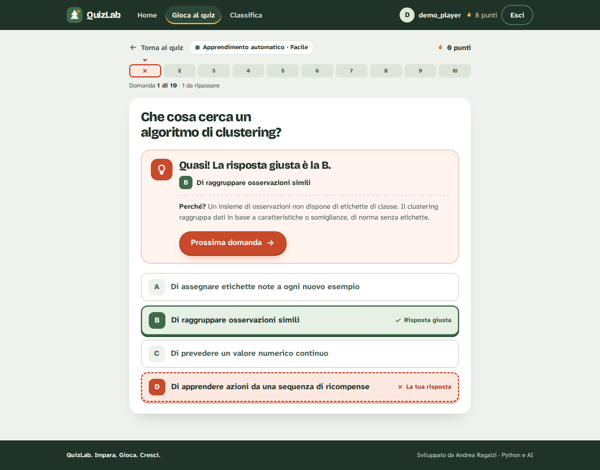
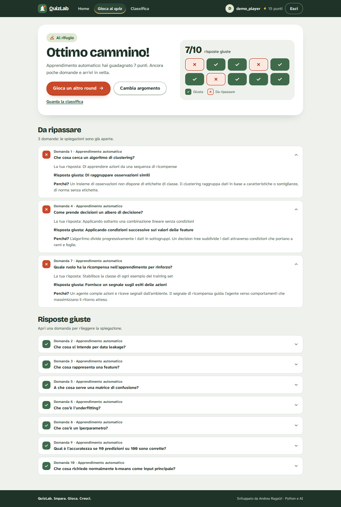
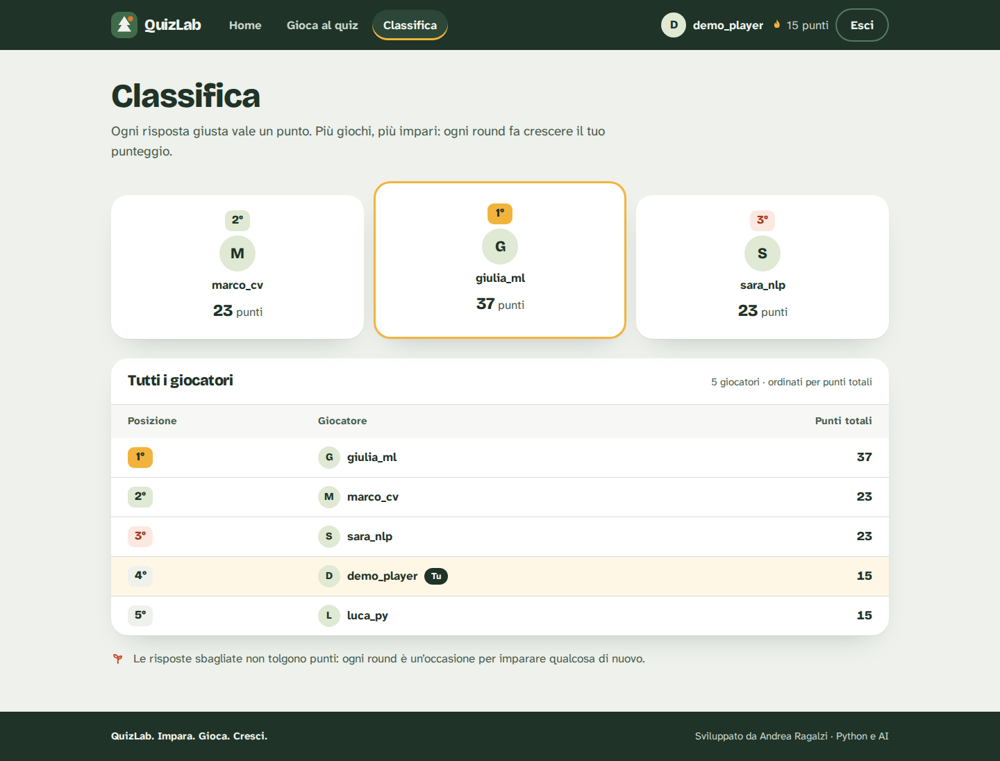
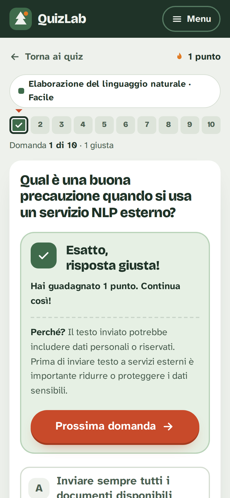

# QuizLab

QuizLab is a Flask application for practising Python and artificial intelligence.
The Italian interface uses 100 questions in four categories: Python, computer
vision, natural language processing, and machine learning.

Each round contains ten questions. Correct answers earn one point, and players
can review their answers and explanations afterwards. Scores and unfinished
rounds are saved. The home page also offers a three-day city forecast from
[Open-Meteo](https://open-meteo.com/).

## Screenshots

The screenshots below use demo players on a temporary database.

**Home page** with the category overview and the three-day forecast:



**Category choice** before starting a round, and **answer feedback** with the
explanation shown after each question:

| Choose a quiz | Answer feedback |
| --- | --- |
|  |  |

**Round results** with answers to review, and the **leaderboard**:

| Round results | Leaderboard |
| --- | --- |
|  |  |

**Mobile layout** (390 px wide):

| Question | Feedback |
| --- | --- |
|  |  |

## Local installation

Python 3.11 or later is required. Internet access is needed to install the
dependencies and retrieve weather forecasts.

```bash
python3 -m venv .venv
source .venv/bin/activate
pip install -r requirements.txt
pip install -e '.[dev]'
export SECRET_KEY="$(python -c 'import secrets; print(secrets.token_hex(32))')"
export COOKIE_SECURE=0
flask --app wsgi:application init-db
flask --app wsgi:application validate-questions
flask --app wsgi:application seed-questions
flask --app wsgi:application run
```

Open <http://127.0.0.1:5000>, register, and choose a category or the mixed quiz.
Keep the same `SECRET_KEY` across restarts to preserve sessions, and store it
outside the repository.

## Configuration and data

`.env.example` lists the environment variables; it is not loaded automatically.
The default database is `instance/quizlab.sqlite`; set `DATABASE_URL` to choose
another path. Use HTTPS and `COOKIE_SECURE=1` in production.

Italian questions are stored in `data/questions_it.json`, each with a reference
URL for its category. To update an existing database, back it up and run
`flask --app wsgi:application import-static-questions`. Questions are updated by
stable ID; users, scores, answers and existing round snapshots are not changed.

## Weather

Forecast temperatures are calculated from hourly readings in the resolved city's
local timezone. Each row shows the highest reading from 06:00 up to 18:00, and
the lowest reading from 18:00 up to 06:00 the following day. The forecast
includes additional hours for the final night and for requests crossing local
midnight. The displayed condition is taken from a daytime reading near noon.
Clock changes are handled using UTC timestamps and the city's timezone. Missing
hourly readings produce an unavailable message. No API key is needed.

## Deployment on PythonAnywhere

Based on the official [Flask hosting guide](https://help.pythonanywhere.com/pages/Flask/).

### 1. Upload and dependencies

Create a web app with **Manual configuration** and Python 3.12. Upload `app/`,
`data/`, `requirements.txt` and `wsgi.py` to `~/quizlab`. Do not upload `.venv/`,
`node_modules/`, caches or secrets, and never overwrite an existing production
`instance/` directory. Node.js and the development tools are not needed on the
server.

```bash
cd ~/quizlab
python3.12 -m venv ~/.virtualenvs/quizlab
source ~/.virtualenvs/quizlab/bin/activate
python -m pip install -r requirements.txt
mkdir -p instance
chmod 700 instance
```

### 2. Private configuration

On the **first installation only**, create `~/.quizlab-env` without printing the
secret. Never regenerate the secret of an existing installation.

```bash
python - <<'PY'
import os
import secrets
from pathlib import Path
config = Path.home() / '.quizlab-env'
with config.open('x') as stream:
    os.chmod(config, 0o600)
    stream.write(f'SECRET_KEY={secrets.token_hex(32)}\n')
    stream.write(f'DATABASE_URL=sqlite:///{Path.home()}/quizlab/instance/quizlab.sqlite\n')
    stream.write('COOKIE_SECURE=1\n')
PY
set -a
source ~/.quizlab-env
set +a
```

The file uses plain `KEY=value` lines (no quotes, no `export`, no spaces in
paths). Keep it outside the repository.

### 3. Database

Back up an existing database **before** importing questions:

```bash
python - <<'PY'
import os
import sqlite3
from datetime import datetime, timezone
from pathlib import Path
from sqlalchemy.engine import make_url
os.umask(0o077)
source_path = make_url(os.environ['DATABASE_URL']).database
stamp = datetime.now(timezone.utc).strftime('%Y%m%dT%H%M%S%fZ')
backup_path = Path.home() / f'quizlab-backup-{stamp}.sqlite'
with sqlite3.connect(f'file:{source_path}?mode=ro', uri=True) as source:
    with sqlite3.connect(backup_path) as target:
        source.backup(target)
print(f'Backup saved to {backup_path}')
PY
```

On a new installation run `flask --app wsgi:application init-db` first. Then:

```bash
flask --app wsgi:application validate-questions
flask --app wsgi:application import-static-questions
```

Both commands should report 100 questions. Never delete or recreate the
production database.

### 4. WSGI file and Web tab

Set the virtualenv to `/home/YOUR_USERNAME/.virtualenvs/quizlab` and replace the
WSGI file with the following, substituting `YOUR_USERNAME`:

```python
import os
import sys
from pathlib import Path

project = '/home/YOUR_USERNAME/quizlab'
sys.path.insert(0, project)
for line in Path('/home/YOUR_USERNAME/.quizlab-env').read_text().splitlines():
    if line.strip() and not line.lstrip().startswith('#'):
        key, value = line.split('=', 1)
        os.environ[key.strip()] = value.strip()

from wsgi import application
```

Map `/static/` to `/home/YOUR_USERNAME/quizlab/app/static/`, force HTTPS, keep
`COOKIE_SECURE=1` and debug disabled, then reload the web app.

### 5. Checks after deployment

Weather must work from the server, not just locally:

```bash
cd ~/quizlab
source ~/.virtualenvs/quizlab/bin/activate
python - <<'PY'
from wsgi import application
with application.app_context():
    result = application.extensions['weather'].forecast('Roma')
    print(result.city)
    for day in result.days:
        print(day.date, day.name, day.condition, day.maximum, day.minimum)
PY
```

Both Open-Meteo hosts are on the
[free-account allowlist](https://www.pythonanywhere.com/whitelist/).
On the public HTTPS URL, check that:

1. CSS and JavaScript load on every page.
2. At 320 and 390 pixels the login is visible, and the quiz link appears after login.
3. A full round works: category, ten answers, feedback, results, and “Gioca
   ancora” keeps the category.
4. Points and leaderboard update, and progress survives logout and a reload.
5. Searching Roma shows three days with conditions and temperatures, with the
   Open-Meteo credit.
6. Error pages are in Italian with no diagnostic details; tracebacks appear only
   in the server error log.
7. Debug is off and the session cookie is Secure, HttpOnly and SameSite=Lax.

## Tests and code quality

Tests use temporary databases and mocked weather requests. Run every quality
check (the same command works locally and in CI):

```bash
pip install -e '.[dev]'   # Ruff, Pyright, pytest, djLint
npm ci                    # Stylelint, ESLint, Prettier (development only)
scripts/check.sh          # fails on lint, type, format or test errors
scripts/check.sh --fix    # apply the formatters first
```

Without Node.js, `QUIZLAB_SKIP_FRONTEND=1 scripts/check.sh` skips the CSS and
JavaScript checks. Each file type has exactly one formatter:

| Tool | Scope |
| --- | --- |
| Ruff | Python lint and formatting |
| Pyright | Python static types (`[tool.pyright]` in `pyproject.toml`) |
| pytest | Tests |
| djLint (Jinja profile) | Template lint and formatting |
| Stylelint | CSS lint (`stylelint.config.mjs`) |
| ESLint | JavaScript lint (`eslint.config.mjs`) |
| Prettier | Standalone CSS and JavaScript formatting |

Pyright uses the interpreter in `.venv` and targets Python 3.11.

## Limitations

Questions repeat after the catalog is exhausted. Weather depends on an external
service; when city names are ambiguous the first match is used. Password reset,
automatic schema migrations, and an administration interface are not available.
SQLite is intended for modest usage.

## Project structure

- `app/__init__.py` creates the application and registers its components.
- `app/routers/` contains Flask blueprints and HTTP request handling.
- `app/services/` contains application rules, transaction boundaries, question import and weather integration.
- `app/repositories/` contains database queries and writes without committing transactions.
- `app/domain/` contains quiz constants, models and question-draw state.
- `app/core/` contains configuration, extensions, security and CLI registration.
- `app/web/` contains forms, authentication helpers, error handling and presentation labels.
- `docs/screenshots/` contains the screenshots shown in this README.
